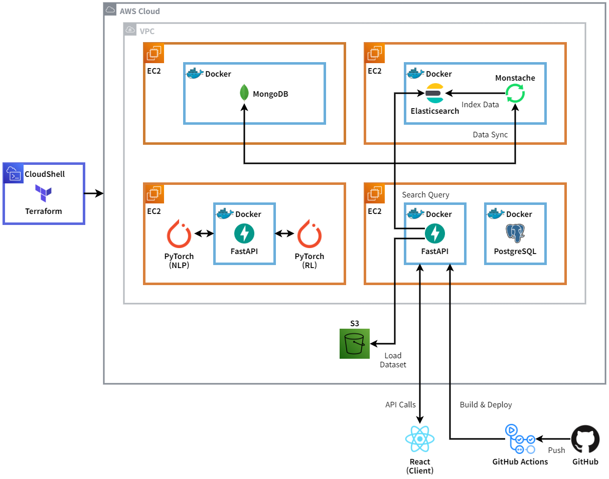

## Architecture Diagram

## ERD Diagram

## 현 백엔드 레포에서 환경변수가 의미하는 게 뭔가요

- `EC2_HOST` : EC2 퍼블릭 IP 주소
- `EC2_KEY` : pem키
- `EC2_PATH` : fastapi 배포 디렉터리
- `EC2_USER` : EC2 인스턴스 사용자 이름
- `SUBMODULES_SSH_KEY` : 서브모듈 관련 키

## Q. main 브랜치 push/merge 시 github actions이 실패해요

- 환경변수 EC2_HOST를 적절한 퍼블릭 IP 주소로 변경

## Q. 리소스 생성했는데 뭔가 이상해요

- EC2 생성 시 세팅 관련 스크립트가 제대로 수행되었는가 ?
`sudo cat /var/log/cloud-init-output.log`

- Kaggle dataset 로그 관련 스크립트가 제대로 수행되었는가 ?
`sudo cat /home/ubuntu/arxiv_sync.log`

- OOM으로 인해 서버가 죽었는가
`sudo dmesg -T | grep -i -E 'killed process|out of memory|oom' || true`

- 현재 서버 메모리 상태가 어떻게 되는가
`free -h`

- 현재 서버의 스왑 메모리 상황이 어떻게 되는가
`swapon --show`

- 캐글 데이터셋을 다운받는 프로세스 상황 확인
`pgrep -fa kaggle`

- 도커 볼륨까지 제거
`docker compose -f docker-compose.local.yml down -v`

- 로컬 develop -> 원격 main force push
`git push origin develop:main --force-with-lease`

- 서브모듈 최신화
`git submodule update --remote`

- 배포 서버 MongoDB down & up
`docker compose -f docker-compose.mongodb.yml down -v`
`docker compose -f docker-compose.mongodb.yml up -d`

- 현재 브랜치 내용을 깃허브의 develop으로 덮어쓰기
`git reset --hard origin/develop`

- 목데이터 세팅 (dev)
`sudo docker exec -it fastapi_dev bash`
`python run_seed.py`

## arXiv 논문 적재와 AI 요약

Spring 적재 작업은 arXiv JSON Lines 스냅샷을 읽습니다. `cs.` 카테고리가 하나라도 있는 논문은 NLP 서버의 `POST /summarize/enrich`로 영·한 요약, 키워드, 임베딩을 만든 뒤 MongoDB에 함께 저장합니다. 같은 원문에 영·한 요약이 이미 있으면 재사용합니다. 요청에 실패한 새 논문은 다음 적재에서 다시 처리하고, 수정 논문은 성공할 때까지 기존 버전을 유지합니다.

| 환경 변수 | 설정 |
| --- | --- |
| `PAPER_INGESTION_SOURCE` | `s3://bucket/path/arxiv-metadata-oai-snapshot.json` 또는 애플리케이션에서 읽을 수 있는 절대 `file:` URI. `.gz`도 지원합니다. S3를 사용하면 실행 환경에 AWS 리전, 읽기 권한, 스냅샷을 내려받을 임시 디스크 공간이 필요합니다. |
| `PAPER_INGESTION_CRON` | 서울 시간 기준 Spring cron. 매일 04:00은 `0 0 4 * * *`입니다. 기본값 `-`는 비활성화입니다. |
| `PAPER_NLP_URL` | 새 요약 API를 배포한 NLP 서버의 기본 URL. 비워 두면 기존 `gpu-server.url`을 사용합니다. |
| `PAPER_REQUIRE_CS_SUMMARY` | `true`이면 영·한 요약이 없는 CS 논문을 검색과 상세 조회에서 제외합니다. 기본값은 `false`입니다. |

NLP 서버의 새 API를 먼저 배포한 뒤 Spring 적재 일정을 설정합니다. 기존 CS 논문이 포함된 스냅샷을 적재하고 실패 건과 영·한 요약이 없는 CS 문서 수를 확인한 뒤 `PAPER_REQUIRE_CS_SUMMARY=true`를 적용합니다. 적재 로그의 실패 건에는 읽지 못한 스냅샷 행과 저장하지 못한 논문이 포함됩니다.

## TODO
- [ ] 서버 재구축 시 kaggle API를 통해 데이터셋 받고, MongoDB에 적재까지 이루어지는 프로세스 구축 (현재는 S3에 미리 저장된 데이터셋을 로드 중)
- [ ] 임시 API 추후 어드민 용으로
- [ ] 백그라운드 데이터 수집
